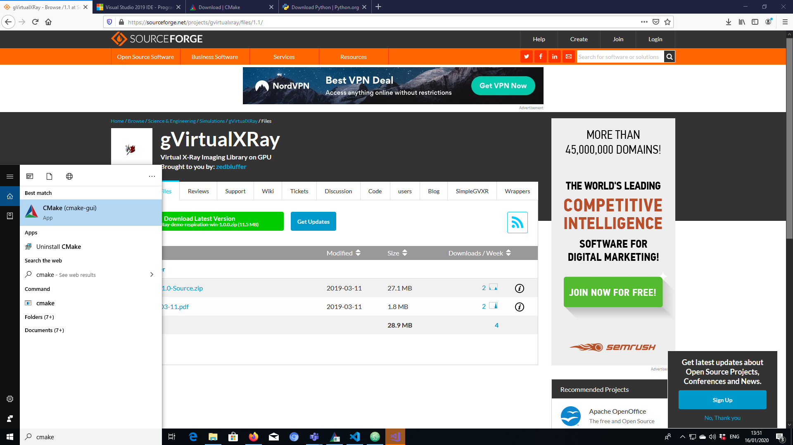
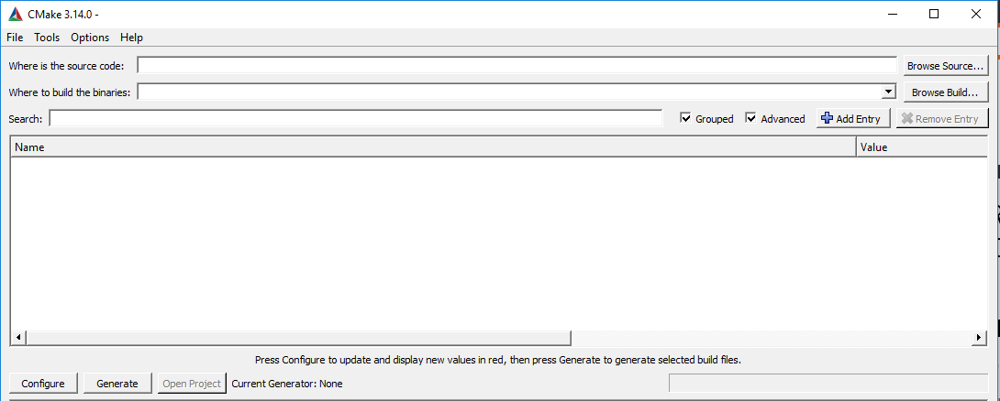
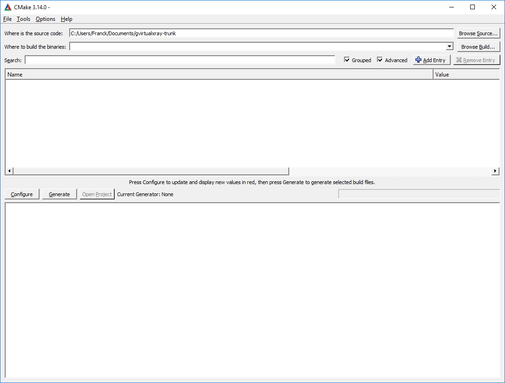
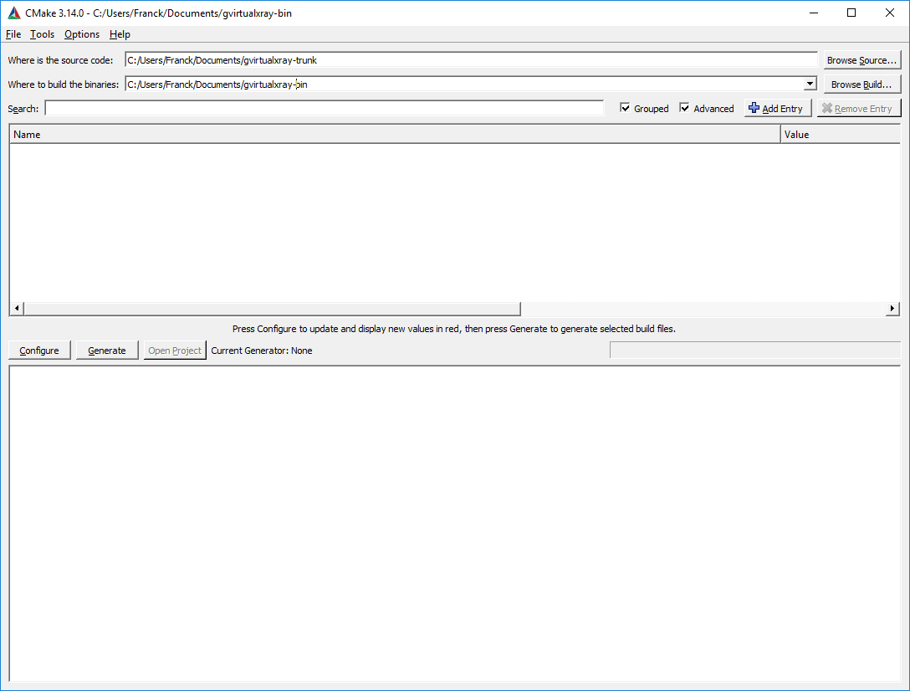
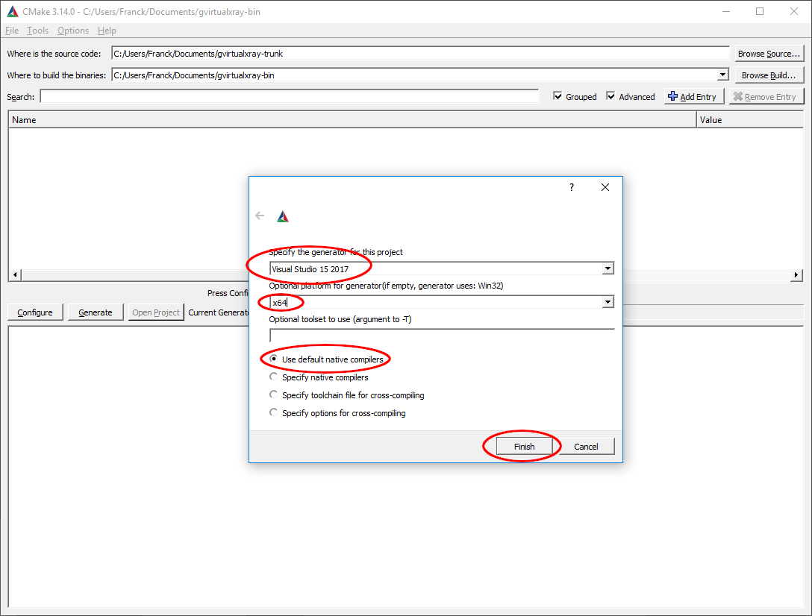
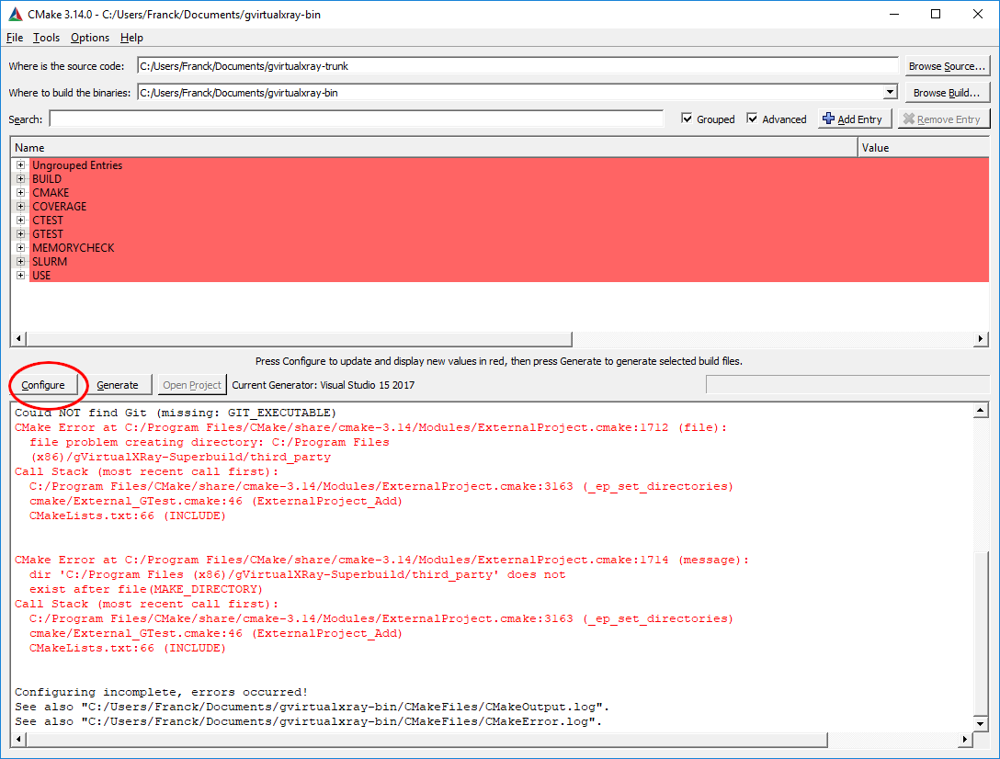
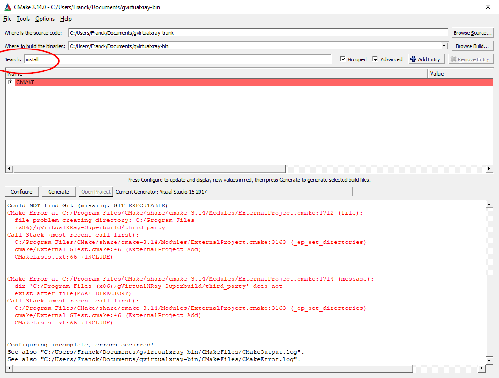
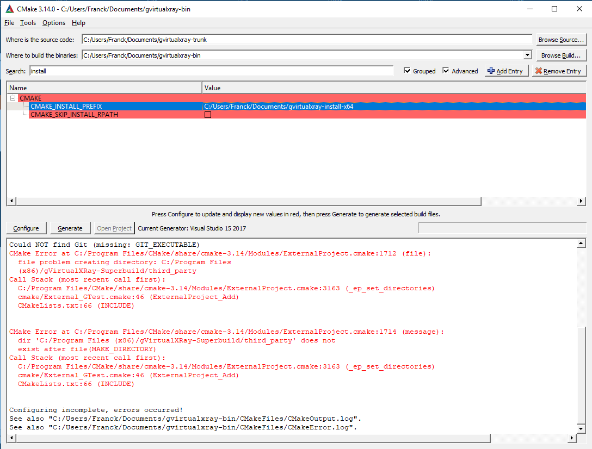
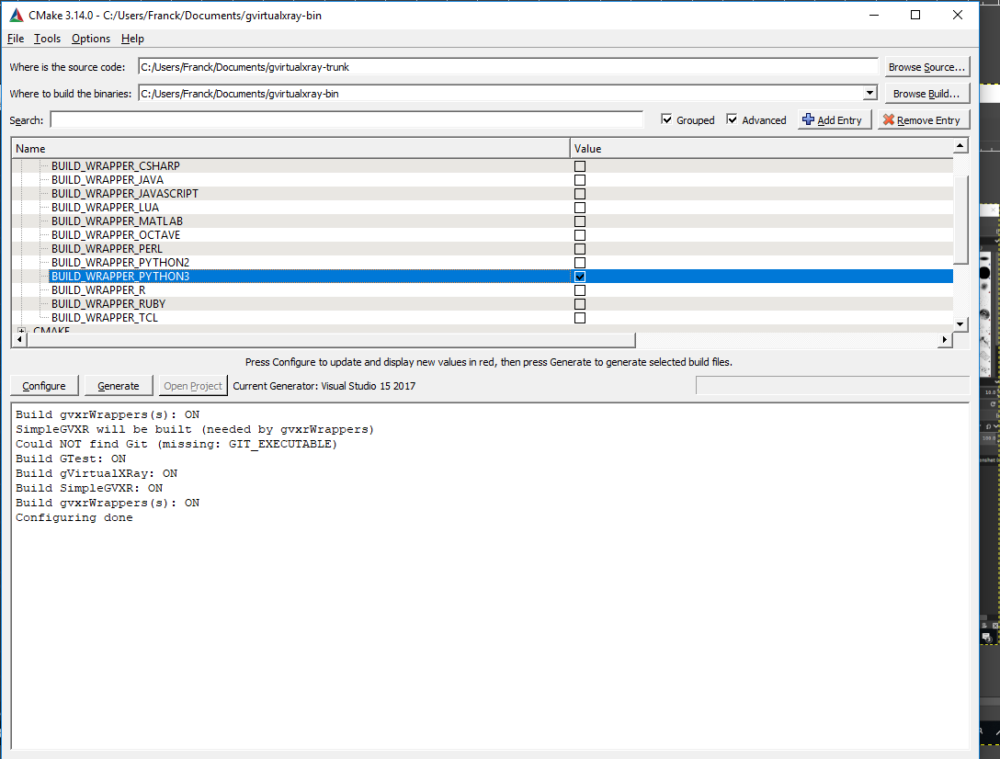
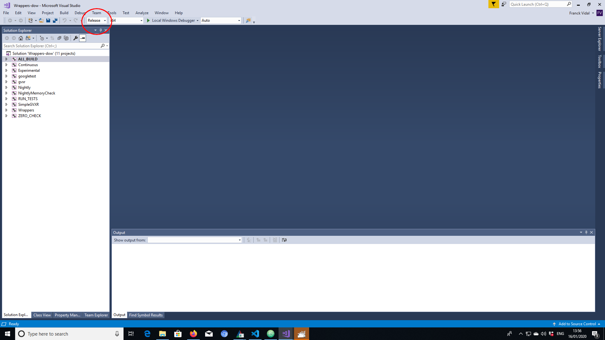

# How to compile and install gVirtualXRay Suite

## First steps

Make sure you have:
- CMake 3.12 or newer (see [http://www.cmake.org/](http://www.cmake.org/));
- A C++ compiler; and
- A GPU that supports OpenGL.

## Download the latest version of the source code

- The latest release [gVirtualXRay-1.1.1-Source.zip](https://sourceforge.net/projects/gvirtualxray/files/1.1/gVirtualXRay-1.1.1-Source.zip/download) is available at [https://sourceforge.net/projects/gvirtualxray/files/1.1/gVirtualXRay-1.1.1-Source.zip/download](https://sourceforge.net/projects/gvirtualxray/files/1.1/gVirtualXRay-1.1.1-Source.zip/download).
- The latest version from SVN at [https://svn.code.sf.net/p/gvirtualxray/code/trunk](https://svn.code.sf.net/p/gvirtualxray/code/trunk).

## For Linux:

1. Using the prompt, go to the directory where you want to compile the project, e.g. your home directory.
```bash
$ cd ~
```
2. Download the code using either
```bash
$ wget https://sourceforge.net/projects/gvirtualxray/files/1.1/gVirtualXRay-1.1.1-Source.zip/download
$ unzip ???
```
or
```bash
$ svn checkout https://svn.code.sf.net/p/gvirtualxray/code/trunk gvirtualxray-code
```
3. Create a directory where the binaries will be created and go in this directory:
```bash
$ mkdir bin
$ cd bin
```
4. Choose where the binaries should be installed, ideally a directory where you can write. If you can't, make sure you use `sudo make` rather than `make` in Steps 6 and 7.
```bash
export GVXR_INSTALL_DIR=$HOME/gvxr-install
```
5. Configure the project using CMake. Use `cmake`, `ccmake` or `cmake-gui` depending on what you prefers.
  - `cmake`:
  ```bash
  $ cmake \
      -DCMAKE_BUILD_TYPE:STRING=Release \
      -DCMAKE_INSTALL_PREFIX:STRING=$GVXR_INSTALL_DIR \
      -DBUILD_WRAPPER_CSHARP:BOOL=ON \
      -DBUILD_WRAPPER_JAVA:BOOL=ON \
      -DBUILD_WRAPPER_OCTAVE:BOOL=ON \
      -DBUILD_WRAPPER_PERL:BOOL=ON \
      -DBUILD_WRAPPER_PYTHON3:BOOL=ON \
      -DBUILD_WRAPPER_R:BOOL=ON \
      -DBUILD_WRAPPER_RUBY:BOOL=ON \
      -DBUILD_WRAPPER_TCL:BOOL=ON \
      -S ../gvirtualxray-code \
      -B $PWD
  ```
  - `ccmake`:
  ```bash
  $ ccmake \
      -DCMAKE_BUILD_TYPE:STRING=Release \
      -DCMAKE_INSTALL_PREFIX:STRING=$GVXR_INSTALL_DIR \
      -S ../gvirtualxray-code \
      -B $PWD
  ```
  - `cmake-gui`:
  ```bash
  $ ccmake \
      -DCMAKE_BUILD_TYPE:STRING=Release \
      -DCMAKE_INSTALL_PREFIX:STRING=$GVXR_INSTALL_DIR \
      -S ../gvirtualxray-code \
      -B $PWD
  ```
6. Compile the project
```bash
$ make -j8
```
I used a parallel build with 8 jobs as I got 8 cores in my CPU. Adjust `-j` depending on your computer.
7. Install the binaries
```bash
$ make install
```

## For Windows

You may skip some of the initial steps depending on the current state of your system. I recommand to use 64 bits for all the components, including Python 3.

1. Download and install a compiler if needed. I recommend Microsoft's Visual Studio C++ from [https://visualstudio.microsoft.com/vs/](https://visualstudio.microsoft.com/vs/).
2. Download and install CMake from [https://cmake.org/download/](https://cmake.org/download/).
3. Download and install Python3 from [https://www.python.org/downloads/](https://www.python.org/downloads/).
4. Download and extract gVirtualXRay's code from [https://sourceforge.net/projects/gvirtualxray/files/1.1/gVirtualXRay-1.1.1-Source.zip/download](https://sourceforge.net/projects/gvirtualxray/files/1.1/gVirtualXRay-1.1.1-Source.zip/download).
5. Open CMake's gui.


6. Select where the source code is. This is the top directory of the repository that contains CMakeLists.txt.

7. Select where the binaries are going to be compiled. It CANNOT be a sub-directory of the source directory chosen in the previous step.

8. Press configure, then choose which compiler you want to use and which architecture. I used Visual Studio 15 2017's native compilers, and x64 (for 64 bits).

9. Click on `Configure`. There'll be an error, but don't worry about it.

10. Search for `install`.

11. Change the variable `CMAKE_INSTALL_PREFIX` into a path where you are allowed to write. Click on configure. If it does not work, change the path and make sure you have write privilege for that path.

12. If you want to build a wrapper, e.g. for Python 3, go to `BUILD` and tick the right option(s) (in my case `BUILD_PYTHON£_WRAPPER`). Now you can click on `Configure`, then `Generate`, then `Open Project`.

13. It will open Visual Studio. Change Debug into Release.

14. Do a right click on `BUILD_ALL` or press the `F7` key to build the project.

15. Go and make some coffee, it's gonna take a bit of time...
