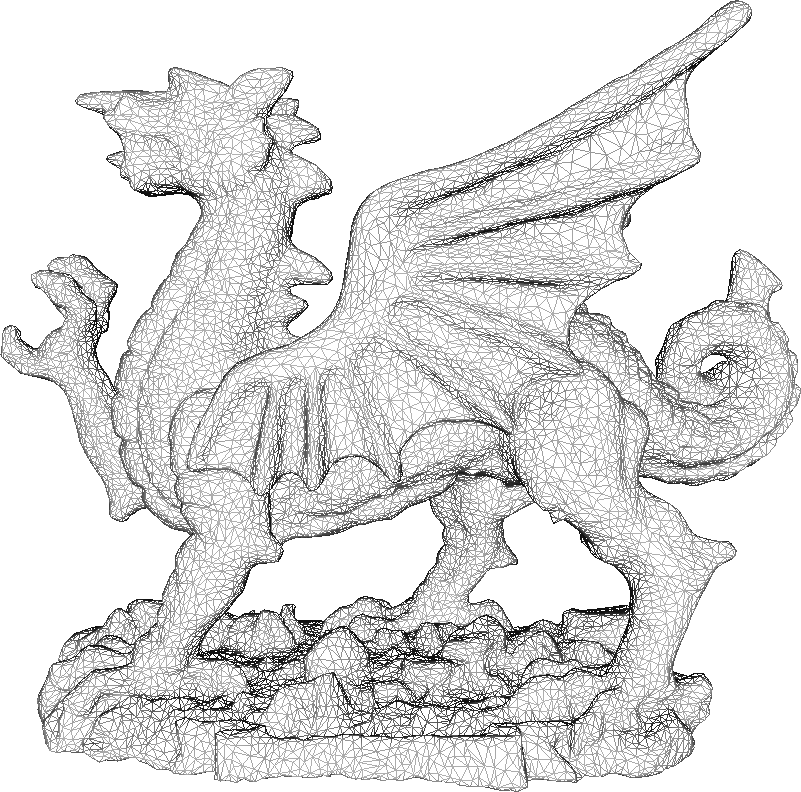

# Rational for this Research

- Simulation of X-Ray attenuation extensively studied in physics;
- Different physically-based simulation code available;
- Physically-based simulation usually performed using Monte Carlo methods on CPU (often used in dosimetry for radiotherapy);
    - Very accurate; but
    - Computing an image requires a very very very long time (e.g. days or weeks);
- Ray-tracing is an alternative, but
    - Still relatively slow on CPU;
    - Does not easily take into account scattering;
    - Does not include Poisson counting noise;
- Scattering does not necessarily matter in X-ray transmission imaging;
- Poisson noise can be added as a post-process.

# Medical Training using VR

- PhD (start 2003) and Postdoc (start 2006) in medical VR;
- Development of VR apps to train Interventional radiologists;
    - Stick needles and catheters in the human body whilst looking at images
    - Such as fluoroscopy;
    - Real-time X-ray images on a TV screen.
- Not interested in scattering;
- Noise is not an issue;
- Ray-tracing is viable in this context.

# Need for a Simulation Library that is

- open-source (with a flexible license)
    - Can be used in open-source projects
    - Can be used in closed source commercial applications too
- Fast
    - GPU implementation.
- Flexible
    - Available for most popular programming languages
- Cross platform
    - Run on GNU/Linux, Mac OS X and Windows
- Validated
    - Compared simulations from a state-of-the-art Monte Carlo code, e.g. 

<!--
# Timeline

- (\scriptsize\fullcite(Freud2003PhD))
- (\scriptsize\fullcite(Vidal2003IS))
- (\scriptsize\Gls(GLSL) included into the OpenGL 2.0 core (2004).)
- (\scriptsize\fullcite(Vidal2008PhD))
- (\scriptsize\fullcite(Vidal2009TPCG))
- (\scriptsize\fullcite(Vidal2010EGPoster))
- (\scriptsize Restart as an open-source project, Dec 2013.)
- (\scriptsize\fullcite(Vidal2016ComputMedImagingGraph))
-->

# Fact sheet

- Open-source (created on 01 Dec 2013)
- SVN repository hosted by 
- Implemented in  using 
- Can also be deployed in  applications;
- Provides real-time performance;
- Is accurate (quantitative validation);
- Reproducibility;
- Supports [: Photon Cross Sections Database](https://physics.nist.gov/PhysRefData/Xcom/html/xcom1.html) from ;
- Uses polygon meshes to model 3-D geometries  from popular file formats (eg. STL, PLY, 3DS, OBJ, DXF, X3D, DAE)
