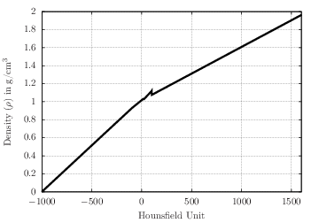

# Quantitative Validation

- Simulating an image relies on a Beer-Lambert law implementation;
- Solving the Beer-Lambert law relies on Linear Attenuation Coefficients; (&mu;)
- &mu; is not known for given incident energies;
- &mu; is computed using Mass Attenuation Coefficients (&mu;/&rho;) and material density (&rho;).
- **Are the values used in gVirtualXRay accurate?**
    - Compare values computed in gVirtualXRay with those from the literature.
- **Are the Beer-Lambert law implementations accurate?**
    - Compare values computed in gVirtualXRay with theoretical ones.
- **Are the simulated images accurate?**
    - Compare images computed using gVirtualXRay with those using a state-of-the-art Monte Carlo software, e.g. 

# Density for Different Materials (human tissues)}

Image from  W. Schneider, T. Bortfeld, and W. Schlegel, “Correlation between CT numbers and tissue parameters needed for Monte Carlo simulations of clinical dose distributions,”Physicsin Medicine & Biology, vol. 45, no. 2, p. 459, 2000.doi:10.1088/0031-9155/45/2/314

# Mass Attenuation Coefficients}

- Any tissue can be described by its Hounsfiled Unit (HU):

 	    - HU(material) = 1000 x (&mu;(material) - &mu;(water)) / &mu;(water)
        - Give a HU value for any simulated object;
        - If &mu;(water) is known for any energy, then &mu;(material) for any HU and for any energy can be computed:
        &mu;(material, E) = &mu;(water, E) x (1 + HU(material)/1000)$$

 	    - 	Mass attenuation coefficients $\left(\frac{&mu;}{&rho;}\right)$ for various human tissues can be found in the literature;

 	    - 	The density (${&rho;}$) for various human tissues can be found in the literature.
 	\end{itemize}

  \end{frame}

  \begin{frame}
# Mass Attenuation Coefficients: Tissue, Soft (ICRU-44)}

    \begin{overprint}
			\onslide<1>\centering\includegraphics[width=0.8\linewidth]{tissue}\\Image from \url{https://physics.nist.gov/PhysRefData/XrayMassCoef/ComTab/tissue.html}
			\onslide<2>\includegraphics[width=\linewidth]{test_soft_tissue_1}\\$&mu;(water)$ from literature is provided at given energies only: Interpolation needed
			\onslide<3>\includegraphics[width=\linewidth]{test_soft_tissue_2}
% 			\onslide<4>\includegraphics[width=\linewidth]{test_soft_tissue_3}

 	    \end{overprint}

  \end{frame}

  \begin{frame}
# Mass Attenuation Coefficients: Bone, Cortical (ICRU-44)}

    \begin{overprint}
			\onslide<1>\centering\includegraphics[width=0.8\linewidth]{bone}\\Image from \url{https://physics.nist.gov/PhysRefData/XrayMassCoef/ComTab/bone.html}
			\onslide<2>\includegraphics[width=\linewidth]{test_bone_2}
			\onslide<3>\includegraphics[width=\linewidth]{test_bone_3}
% 			\onslide<4>\includegraphics[width=\linewidth]{test_soft_tissue_3}

 	    \end{overprint}

  \end{frame}

%   \begin{frame}
% # Beer-Lambert Law: Monochromatism Case}
%  	\begin{columns}
%  	\begin{column}{0.65\linewidth}

%  	\begin{description}
%  	    \item[Cube:] edge length of 3~cm, made of soft tissue (HU = 52).
%  	    \item[Cylinder:] height of 3~cm, diameter of 2~cm, made of bone (HU = 1330).
%         \item[Incident energy:] 0.08 MeV (i.e. 80 keV).
%  	\end{description}
%  	\end{column}
%  	\begin{column}{0.35\linewidth}
%  	\centering\includegraphics[width=\linewidth]{validation_3D_scene}
%  	\end{column}
%  	\end{columns}

% % Fig. 1. Sample used in the simulation.

% % The incident energy, Ii, is 0.08 MeV (i.e. 0.08 MeV).

%   \end{frame}

%   \begin{frame}
% # Beer-Lambert Law: Monochromatism Case}

% Material properties from the literature at 0.08~MeV (i.e. 80~keV)
% \begin{scriptsize}
% \begin{tabular}{|c|c|c|c|c|}
% \hline
% % Material &	HU (estimated at 0.08 MeV) &	Density ($&rho;$) (in g/cm$^3$) &	Mass attenuation coefficient ($&mu;/&rho;$) at 0.08 MeV (in~cm$^2$/g) &	Linear attenuation coefficient ($&mu;$) at 0.08 MeV (in~cm$^{-1}$)\\
% \textbf{Material} &	\textbf{HU}	& $\bm{&rho;}$ &	$\bm{&mu;/&rho;}$&	$\bm{&mu;}$\\
% \hline
% \hline
% Water, Liquid &	0.000 &	1.000E+00 &	1.837E-01 &	1.837E-01 \\
% \hline
% Bone, Cortical (ICRU-44) &	1329.886 &	1.920E+00 &	2.229E-01 &	4.280E-01\\
% \hline
% Tissue, Soft (ICRU-44) &	51.715 &	1.060E+00 &	1.823E-01 &	1.932E-01\\
% \hline

% \end{tabular}
% \end{scriptsize}
% \vfill

% % The energy, Io, (in MeV) transmitted orthogonally throw the middle of cube and cylinder should be:

% % Io = Ii × e-∑(mu × x) = 0.080 × e(-(μbone × 2 + μsoft tissue × 1)) = 0.080 × e(-(4.280E-01 × 2 + 1.932E-01 × 1)) = 2.802E-02 MeV

%  The energy, $I_{out}$, (in MeV) transmitted orthogonally throw the middle of cube and cylinder should be:
% \begin{align*}
%  I_{out} &= I_{in} \times \exp \left( -\sum_i &mu;_i  x_i\right) \\
%  &=       0.080 \times \exp \left( - \left( \expnumber{4.280}{-01} \times 2 + \expnumber{1.932}{-01} \times 1 \right)\right) \\
% &= \expnumber{2.802}{-02}
% \end{align*}
%  On GPU, the energy, $I'_{out}$, is: $\expnumber{2.979}{-02}$

%   The relative error is:
% $$\frac{\left|I'_{out} - I_{out}\right|}{I_{out}} = 5.6\%$$

%   \end{frame}

  \begin{frame}
# Beer-Lambert Law: Polychromatism Case}
 	\begin{columns}
 	\begin{column}{0.65\linewidth}

 	\begin{description}
 	    \item[Cube:] Edge length of 3~cm, made of soft tissue (HU = 52).
 	    \item[Cylinder:] Height of 3~cm, diameter of 2~cm, made of bone (HU = 1330).
        \item[Incident energy:]
        \begin{scriptsize}
        \begin{tabular}{|c|c|}
        \hline
        $\bm{N:}$ \textbf{Number of } &		$\bm{E:}$ \textbf{Energy }\\
        \textbf{ photons} &		\textbf{(in MeV)}\\
        \hline
        \hline
10 &	 	0.1\\
        \hline
20 &	 	0.2\\
        \hline
10 &	 	0.3\\
        \hline

                \end{tabular}\end{scriptsize}

 	\end{description}
 	\end{column}
 	\begin{column}{0.35\linewidth}
 	\centering\includegraphics[width=\linewidth]{validation_3D_scene}
 	\end{column}
 	\end{columns}

% Fig. 1. Sample used in the simulation.

% The incident energy, Ii, is 0.08 MeV (i.e. 0.08 MeV).

  \end{frame}

  \begin{frame}
# Beer-Lambert Law: Polychromatism Case}

\begin{itemize}

- Use material properties from the literature;

-  The energy, $I_{out}$, (in MeV) transmitted orthogonally throw the middle of cube and cylinder should be:
\begin{align*}
 I_{out} &= I_{out}(0.1) + I_{out}(0.2) + I_{out}(0.3)\\
I_{out}(0.1)  &=    10 \times 0.1 \times \exp \left( - \left( \expnumber{3.346}{-01} \times 2 + \expnumber{1.799}{-01} \times 1 \right)\right)\\
I_{out}(0.2)  &=    10 \times 0.1 \times \exp \left( - \left( \expnumber{2.361}{-01} \times 2 + \expnumber{1.443}{-01} \times 1 \right)\right)\\
I_{out}(0.3)  &=    10 \times 0.1 \times \exp \left( - \left( \expnumber{2.008}{-01} \times 2 + \expnumber{1.249}{-01} \times 1 \right)\right)\\
 I_{out} &= 4.359
%  \times \exp \left( -\sum_i &mu;_i  x_i\right)\rigth)
 %  \sum_c \left(I_{in} \times \exp \left( -\sum_i &mu;_i  x_i\right)\rigth) \\
%  &=       0.080 \times \exp \left( - \left( \expnumber{4.280}{-01} \times 2 + \expnumber{1.932}{-01} \times 1 \right)\right) \\
% &= \expnumber{2.802}{-02}
\end{align*}
- On GPU, the energy, $I'_{out}$, is: 4.353.

   - The relative error is:
 $$\frac{\left|I'_{out} - I_{out}\right|}{I_{out}} = 0.1\%$$
\end{itemize}

  \end{frame}

%   \begin{frame}
% # Radon Transform}
%   \end{frame}

%   \begin{frame}
% # Tomography Reconstruction}
%   \end{frame}

  \begin{frame}
# Gate vs. gVirtualXRay}

 	We simulate a test case twice:
\begin{itemize}
    - Using a Monte Carlo method for particle physics implemented in GATE\,\footnotemark;

    - Using our GPU implementation.
\end{itemize}

\vfill

 	\begin{footnotesize}
 	\footnotemark[1] {GATE is an opensource software developed by an international collaboration. Its focus is on Monte Carlo simulation in medical imaging and radiotherapy. GATE makes use of the Geant4 libraries. Geant 4 is CERN's Monte Carlo simulation platform dedicated to particle physics in nuclear research. CERN is the European Organization for Nuclear Research.}
 	\end{footnotesize}
  \end{frame}

  \begin{frame}
# Gate vs. gVirtualXRay: Point Source}
 					\begin{overprint}

\onslide<1>\centering\includegraphics[width=0.4\linewidth]{POINT_SOURCE/scene}

\onslide<2>\null\hfill\includegraphics[width=0.5\linewidth]{POINT_SOURCE/gate_norm}\hfill\includegraphics[width=0.5\linewidth]{POINT_SOURCE/gpu_norm}\hfill\null\\ \null\hfill GATE\hfill gVirtualXRay\hfill\null \\\hfill\null\\ \null\hfill (13.8 days of computations)\hfill (less than 1 sec. of computation)\hfill\null \\ \vfill Normalised cross-correlation (NCC) = 99.747\%

% \onslide<3>\includegraphics[width=\linewidth]{POINT_SOURCE/test_profile}
				\end{overprint}
  \end{frame}

  \begin{frame}
# Gate vs. gVirtualXRay: Uncentered Source}

 					\begin{overprint}

\onslide<1>The source has been translated by a vector: -5.0 0.5 0.5 cm.
\onslide<2>\null\hfill\includegraphics[width=0.5\linewidth]{UNCENTRED_SOURCE/gate_norm}\hfill\includegraphics[width=0.5\linewidth]{UNCENTRED_SOURCE/gpu_norm}\hfill\null\\ \null\hfill GATE\hfill gVirtualXRay\hfill\null \\\hfill\null\\ \null\hfill (12.9 days of computations)\hfill (less than 1 sec. of computation)\hfill\null \\ \vfill Normalised cross-correlation (NCC) = 99.656\%

% \onslide<3>\includegraphics[width=\linewidth]{UNCENTRED_SOURCE/test_profile}
				\end{overprint}

  \end{frame}

 \begin{frame}
# Gate vs. gVirtualXRay: Cube Source}
 					\begin{overprint}

\onslide<1>\centering\includegraphics[width=0.4\linewidth]{CUBE_SOURCE/scene}

\onslide<2>\null\hfill\includegraphics[width=0.5\linewidth]{CUBE_SOURCE/gate_norm}\hfill\includegraphics[width=0.5\linewidth]{CUBE_SOURCE/gpu_norm}\hfill\null\\ \null\hfill GATE\hfill gVirtualXRay\hfill\null \\\hfill\null\\ \null\hfill (14.4 days of computations)\hfill (less than 1 sec. of computation)\hfill\null \\ \vfill Normalised cross-correlation (NCC) = 99.743\%

% \onslide<3>\includegraphics[width=\linewidth]{CUBE_SOURCE/test_profile}
				\end{overprint}
  \end{frame}

%  \begin{frame}
% # Computational performance}

%  	\begin{itemize}
%  	  \item	Use of respiration examples to assess the speed of computations;
%  	  - 41,710 triangles are used in total;
%  - 	500 iterations are computed with (1) and without (2) artefact correction;
%  - 	The tests are repeated 15 times;
%   \item	Computers bought in 2010, 2011, 2012, 2013 and 2014 have been used.

%  	\end{itemize}
% \vfill
%  	\begin{tiny}
%  	\begin{tabular}{|c|c|c|c|c|c|}
%  	\hline
%  	\textbf{CPU}	& \textbf{GPU}	&\textbf{(1)}&	\textbf{(2)}&	\textbf{Respiration}	&\textbf{Year}\\
% 	\hline
%  	\hline
%  AMD FX-8 8350 @ 4.00 GHz&	AMD Radeon R9 285&	101&	149&	528&	2014\\
% 	\hline
%  Intel(R) Core(TM) i7-3770 @ 3.40 GHz	&NVIDIA Quadro K5000&	77&	115&	612	&2013\\
% 	\hline
%  Intel(R) Core(TM) i7-3667U @ 2.00 GHz&	Intel HD Graphics 4000&	13&	49	&315	&2012\\
% 	\hline
%  Intel(R) Core(TM) i7 X 990 @ 3.47 GHz	&NVIDIA GeForce GTX 580	&91	&92	&718	&2011\\
% 	\hline
%  Intel Core 2 Duo @ 2.66 GHz&	NVIDIA GeForce 320M	&16&	31	&221&	2010\\
% 	\hline
%   	\end{tabular}

%  	\end{tiny}

%  	\vfill
%  	Real-time performance on every tested platform, even 8 year old laptops.

%   \end{frame}
